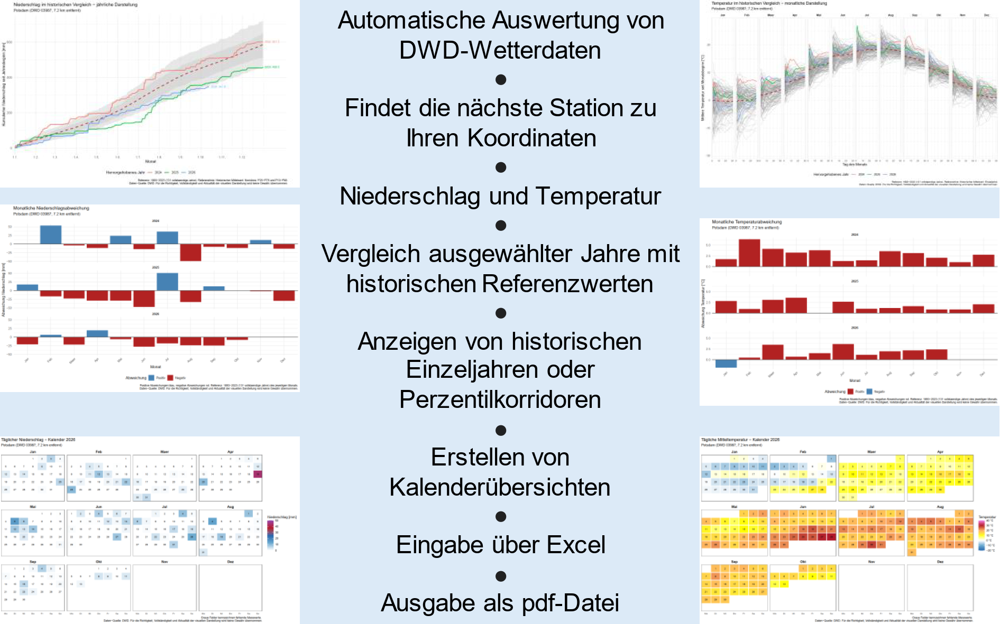
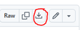
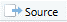

**Wetterdaten für den eigenen Standort automatisch auswerten**

**Wie lassen sich Niederschlag und Temperatur am eigenen Standort mit
frei verfügbaren DWD-Daten auswerten und mit vergangenen Jahren
vergleichen?** Dieses Praxisbeispiel zeigt, wie sich mit einer
Excel-Eingabedatei und einem R-Skript automatisch übersichtliche
Wetterdiagramme erstellen lassen.

**Erforderlicher Wissensstand:** Fortgeschrittenes Wissen

**Zusammenfassung**

**Ziel**

Niederschlag und Temperatur beeinflussen die Entwicklung
landwirtschaftlicher Kulturen, die Befahrbarkeit von Flächen, die
Bodenbearbeitung und den Wasserbedarf der Pflanzen. Für betriebliche
Entscheidungen ist deshalb nicht nur das aktuelle Wetter relevant. Auch
der Vergleich mit vergangenen Jahren hilft dabei, die Witterung am
eigenen Standort besser einzuordnen.

Mit der hier vorgestellten Anwendung lassen sich frei verfügbare
Wetterdaten des Deutschen Wetterdienstes (DWD) automatisiert abrufen und
auswerten. Dafür werden lediglich die Koordinaten des gewünschten
Standorts und einige Einstellungen in einer Excel-Datei benötigt. Das
R-Skript übernimmt anschließend die Stationssuche, den Datenabruf, die
Auswertung und die Erstellung der Diagramme.

Die Ergebnisse werden als PDF-Dateien gespeichert und können
beispielsweise für die betriebliche Dokumentation, die Planung von
Feldarbeiten oder die Einordnung außergewöhnlicher Witterungsverläufe
genutzt werden.

**Durchführung**

Die Anwendung besteht aus zwei Dateien: einer Excel-Arbeitsmappe für die
Eingaben und einem R-Skript für die Berechnung. Nach der Einrichtung
werden die gewünschten Parameter und Jahre in Excel eingestellt.
Anschließend wird das Skript in RStudio gestartet. Die Wetterdaten
werden direkt von den DWD-Servern abgerufen und ausgewertet.

**Ergebnis**

Für Niederschlag und Temperatur können jeweils mehrere Darstellungen
erzeugt werden:

-   **Jahresverlauf:** Entwicklung seit Jahresbeginn im Vergleich zu
    historischen Verläufen.

-   **Monatsdarstellung:** Entwicklung innerhalb der einzelnen Monate im
    historischen Vergleich.

-   **Monatliche Abweichungen:** Einordnung ausgewählter Jahre gegenüber
    einer historischen Referenz.

-   **Wetterkalender:** Tageswerte der ausgewählten Jahre in einer
    farbigen Kalenderübersicht.

Die fertigen Diagramme werden als PDF-Dateien im festgelegten
Ausgabeordner gespeichert.

**Bestandteile**

-   Computer mit Internetzugang

-   R und RStudio

-   Excel-kompatibles Tabellenkalkulationsprogramm

-   Excel-Eingabedatei FarmWissen_DWD_Eingabe.xlsx

-   R-Skript FarmWissen_DWD_Auswertung.R

-   Frei verfügbare Wetterdaten des Deutschen Wetterdienstes

------------------------------------------------------------------------

**Anleitung**

**Einrichtung**

**Schritt 1: Download des zip-Ordners mit der Anwendung**

Laden Sie den zip-Ordner unter folgendem Link herunter:
<https://github.com/svosspro/DWD-Climate-Analysis/blob/main/Anwendung.zip>
und entpacken Sie ihn auf Ihrer Festplatte.

**Schritt 2: R installieren**

R ist eine kostenlose Softwareumgebung für statistische Berechnungen und
die Erstellung von Grafiken. Das R-Skript nutzt sie, um die Wetterdaten
einzulesen, aufzubereiten und auszuwerten.

Laden Sie R von der offiziellen Projektseite herunter und installieren
Sie es:

[**R herunterladen -- The R Project for Statistical
Computing**](https://www.r-project.org/)

Unter Windows führt der Download über CRAN zum passenden
Installationsprogramm.

**Schritt 3: RStudio installieren**

RStudio ist eine Entwicklungsumgebung, mit der sich R-Skripte
übersichtlich öffnen und ausführen lassen. Sie erleichtert insbesondere
den Einstieg, weil der Programmcode, die Konsolenausgabe und die
erzeugten Grafiken in einer Oberfläche zusammengefasst sind.

Laden Sie die kostenlose Desktop-Version herunter:

[**RStudio Desktop herunterladen --
Posit**](https://posit.co/downloads/)

Installieren Sie R zuerst und anschließend RStudio. RStudio ersetzt R
nicht, sondern dient als Arbeitsoberfläche dafür.

**Durchführung**

**Schritt 4: Den gewünschten Standort eingeben**

Öffnen Sie die Excel-Datei und wechseln Sie zum Tabellenblatt
**„Eingaben"**. Tragen Sie den Breitengrad und Längengrad des
gewünschten Standorts in Dezimalgrad ein.

Die Koordinaten können beispielsweise aus einem Kartenprogramm
übernommen werden. Achten Sie darauf, dass sie zum gewünschten Standort
passen.

Das Skript sucht anhand dieser Koordinaten nach einer möglichst nahe
gelegenen DWD-Wetterstation. Es prüft zusätzlich, ob die benötigten
Wetterdaten für die ausgewählten Parameter verfügbar sind. Wenn
Niederschlag und Temperatur gemeinsam ausgewertet werden sollen, muss
die gefundene Station Daten für beide Parameter bereitstellen.

Die Anwendung verwendet somit Messwerte einer DWD-Station und keine
direkt am Standort erhobenen Messwerte. Die Entfernung zur ausgewählten
Station wird in den Diagrammen angegeben.

**Schritt 5: Auswertung einstellen**

In der Excel-Datei können Sie folgende Einstellungen vornehmen:

-   **Hervorzuhebende Jahre:** Geben Sie die gewünschten Jahreszahlen
    durch Kommas getrennt ein, beispielsweise 2024, 2025, 2026.

-   **Niederschlag auswerten:** Wählen Sie „Ja" oder „Nein".

-   **Temperatur auswerten:** Wählen Sie „Ja" oder „Nein". Mindestens
    einer der beiden Parameter muss aktiviert sein.

-   **Historische Referenz:** Wählen Sie „Mittelwert" oder „Median".

-   **Beschriftungen:** Legen Sie fest, ob ausgewählte Endwerte und
    Abweichungen in den Diagrammen beschriftet werden.

-   **Darstellung historische Referenz:** Wählen Sie zwischen „Korridor"
    und „Alle Jahre". Im Korridormodus wird die historische Streuung als
    farblich abgesetzter Bereich dargestellt. Bei „Alle Jahre" werden
    die einzelnen historischen Jahresverläufe als Linien angezeigt.

-   **PDF-Ausgabeordner:** Geben Sie an, in welchem Ordner die
    Ergebnisse gespeichert werden sollen.

-   **Aktualisierung der DWD-Stationsliste und -karte:** Legen Sie fest,
    ob zusätzlich die Stationsliste und die interaktive Stationskarte
    aktualisiert werden sollen.

Speichern Sie die Excel-Datei nach der Änderung.

**Schritt 6: Das R-Skript starten**

Öffnen Sie FarmWissen_DWD_Auswertung.R durch Doppelklick. RStudio muss
vorher geschlossen sein. Somit stellen Sie sicher, dass das richtige
Arbeitsverzeichnis eingestellt ist.

Führen Sie das Skript mit der Schaltfläche **„Source"**
} im Skriptfenster aus. Beim ersten
Durchlauf kann die Ausführung länger dauern, weil benötigte Pakete
installiert und Wetterdaten heruntergeladen werden.

Das Skript sucht eine geeignete DWD-Station, lädt die verfügbaren
Tagesdaten für die gewählten Parameter herunter und berechnet die
Vergleichswerte. Anschließend werden die Diagramme erstellt und als PDF
gespeichert.

Die Ausführung ist abgeschlossen, wenn RStudio eine entsprechende
Fertigmeldung ausgibt. Falls eine Fehlermeldung erscheint, prüfen Sie
zunächst die Internetverbindung, die Excel-Eingaben und das
Arbeitsverzeichnis.

------------------------------------------------------------------------

**Auswertung und Datenmanagement**

**Schritt 7: Jahresverlauf im historischen Vergleich**

Das Jahresdiagramm zeigt, wie sich die Witterung seit Jahresbeginn
entwickelt hat.

Beim Niederschlag wird die Niederschlagssumme seit dem 1. Januar
dargestellt. Bei der Temperatur wird die mittlere Temperatur seit
Jahresbeginn gezeigt. Die ausgewählten Jahre werden farblich
hervorgehoben.

Die historischen Daten dienen als Vergleichsgrundlage. Je nach
Einstellung zeigt das Diagramm den historischen Mittelwert oder Median
als Referenzlinie. Zusätzlich kann ein historischer Korridor
eingeblendet werden: Der äußere Bereich reicht vom 10. bis zum 90.
Perzentil, der innere Bereich vom 25. bis zum 75. Perzentil. Dadurch
lässt sich erkennen, ob ein Verlauf innerhalb der üblichen historischen
Schwankungsbreite liegt oder davon abweicht.

Alternativ können die einzelnen historischen Jahresverläufe als graue
Linien dargestellt werden. So wird sichtbar, wie stark die Witterung
zwischen den Jahren schwankt.

**Schritt 8: Monatsdarstellung**

Die Monatsdarstellung unterteilt das Jahr in zwölf einzelne
Monatsdiagramme. Dadurch lassen sich Unterschiede zwischen den Monaten
leichter erkennen.

Beim Niederschlag wird die Summe seit Monatsbeginn gezeigt. Bei der
Temperatur wird der mittlere Temperaturwert innerhalb des jeweiligen
Monats im bisherigen Monatsverlauf dargestellt. Auch hier können
ausgewählte Jahre mit der historischen Referenz und dem Korridor
verglichen werden.

Die Darstellung unterstützt dabei, beispielsweise einen ungewöhnlich
trockenen Monatsverlauf oder eine auffällige Temperaturentwicklung zu
erkennen.

**Schritt 9: Monatliche Abweichungen**

Die Abweichungsdiagramme zeigen, wie sich ausgewählte Jahre gegenüber
der historischen Referenz unterscheiden.

Für den Vergleich werden die Werte des ausgewählten Jahres und die
historischen Werte jeweils nur bis zum gleichen Kalendertag des
betreffenden Monats berücksichtigt. Dadurch können auch noch nicht
abgeschlossene Monate sinnvoller verglichen werden.

Die Balken zeigen, ob bis zum jeweiligen Stichtag mehr oder weniger
Niederschlag gefallen ist beziehungsweise ob die Temperatur über oder
unter der historischen Referenz liegt.

**Schritt 10: Wetterkalender lesen**

Für jedes ausgewählte Jahr wird zusätzlich ein Wetterkalender erstellt.
Jeder Tag ist als farbiges Feld dargestellt. Die Farbe zeigt den
täglichen Niederschlagswert beziehungsweise die tägliche mittlere
Temperatur an. Graue Felder kennzeichnen fehlende Messwerte.

Die Kalenderübersicht hilft dabei, einzelne besonders nasse, trockene,
kalte oder warme Tage schnell zu erkennen und den Verlauf innerhalb
eines Jahres zu überblicken.

**Schritt 11: PDF-Dateien und weitere Ergebnisse verwenden**

Die PDF-Dateien werden im in Excel angegebenen Ausgabeordner abgelegt.
Für Niederschlag und Temperatur wird jeweils eine eigene Datei erzeugt,
sofern der entsprechende Parameter aktiviert ist.

Wird das Skript erneut ausgeführt, werden neue PDF-Dateien mit dem
aktuellen Datum im Dateinamen erstellt.

Wenn die Aktualisierung der Stationsliste und -karte aktiviert ist,
erzeugt das Skript außerdem eine Datei mit Stationsinformationen und
eine interaktive HTML-Karte. In der Karte können die dargestellten
DWD-Stationen mit der Maus erkundet werden.

------------------------------------------------------------------------

**Ergebnisse und Potenzial**

**Technologisches Potenzial**

-   **Beitrag zur digitalen Transformation:** Frei verfügbare
    Wetterdaten werden automatisiert abgerufen, verarbeitet und
    visualisiert.

-   **Vereinfachtes Datenmanagement:** Wiederkehrende Auswertungen
    erfolgen mit denselben Einstellungen und müssen nicht jedes Mal
    manuell erstellt werden.

-   **Nachvollziehbarkeit:** Die gewählten Jahre, die historische
    Referenz und die Darstellungsform können angepasst werden.

**Ökonomisches Potenzial**

Die Anwendung kann die Einordnung der Witterung und damit die
betriebliche Planung unterstützen. Beispielsweise lassen sich
Niederschlagsdefizite, außergewöhnlich nasse Phasen und
Temperaturabweichungen frühzeitig im historischen Kontext erkennen.

Eine direkte Einsparung von Betriebsmitteln oder eine Ertragssteigerung
wird durch die Anwendung allein nicht gewährleistet. Ihr Nutzen besteht
darin, Informationen für eigene Entscheidungen übersichtlich
bereitzustellen.

**Ökologisches Potenzial**

Die zeitliche Einordnung von Niederschlag und Temperatur kann helfen,
Witterungsbedingungen bei der Planung von Feldarbeiten oder bei der
Bewertung des Wasserbedarfs zu berücksichtigen. Die Anwendung berechnet
jedoch keine direkte Bodenfeuchte, Pflanzenwasserbilanz oder
Bewässerungsempfehlung.

------------------------------------------------------------------------

**Zusätzliche Ressourcen**

**Einordnung**

-   **Produktionsbereich:** Pflanze

-   **Einsatzhäufigkeit:** Bei Bedarf, beispielsweise mehrmals während
    der Vegetationsperiode

-   **Übertragbarkeit:** Grundsätzlich auf Standorte mit verfügbaren
    DWD-Messdaten übertragbar

-   **Kosten:** R, RStudio Desktop und die verwendeten DWD-Daten sind
    kostenlos verfügbar.

-   **Voraussetzungen:** Grundlegende Computerkenntnisse; die
    Einrichtung erfordert die Installation der Software und die korrekte
    Ablage der Dateien.

**Technische Details**

**Software**

-   R -- statistische Berechnung und Grafikerstellung

-   RStudio Desktop -- Entwicklungsumgebung

-   Excel

**Datenquellen**

-   Deutscher Wetterdienst (DWD), Climate Data Center: [Frei verfügbare
    Klimadaten](https://opendata.dwd.de/climate_environment/CDC/observations_germany/climate/daily/)

-   BKG (<https://www.bkg.bund.de>), dl-de/by-2-0
    (<https://www.govdata.de/dl-de/by-2-0>)

**Ergebnisse**

-   PDF-Dateien mit Jahresverlauf, Monatsdarstellung,
    Abweichungsdiagrammen und Wetterkalendern

-   Optional eine Stationsliste und eine interaktive HTML-Karte

**Hinweise zur Interpretation**

Die ausgewerteten Daten stammen von der ausgewählten DWD-Wetterstation.
Die Station kann räumlich vom betrachteten Standort entfernt liegen;
insbesondere bei Niederschlag können deshalb Unterschiede auftreten.
Auch Messlücken, Änderungen an Stationen und zeitverzögerte
Datenaktualisierungen sind bei der Interpretation zu berücksichtigen.

Als historische Referenz werden nur vollständig verfügbare
abgeschlossene Jahre verwendet, die nicht als hervorzuhebende Jahre
ausgewählt wurden. Das laufende Kalenderjahr wird gesondert behandelt.
Die historischen Korridore beschreiben die Streuung der verfügbaren
Daten und sind keine Wettervorhersage.

Die Anwendung dient der Information und Entscheidungsunterstützung. Sie
ersetzt weder die Prüfung der Datenqualität noch die standortbezogene
fachliche Beurteilung.

------------------------------------------------------------------------

**Informationen zu Autoren**

**Autor/in:** Sebastian Voß\
**Institution/Projekt:** Leibniz-Institut für Agrartechnik und
Bioökonomie e.V. (ATB)\
**Kontakt:** <svoss@atb-potsdam.de>
